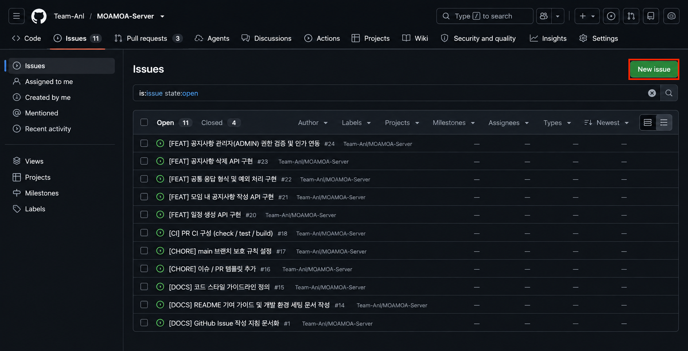
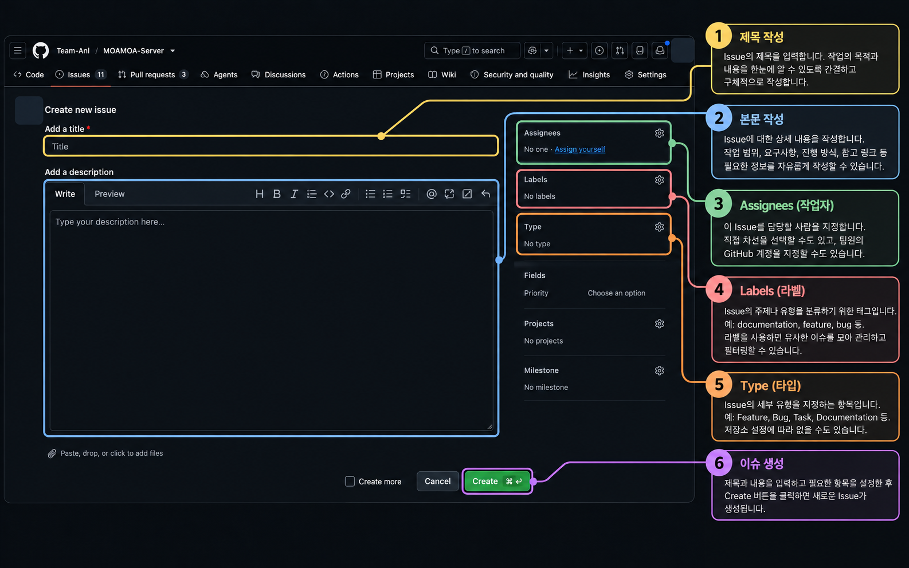
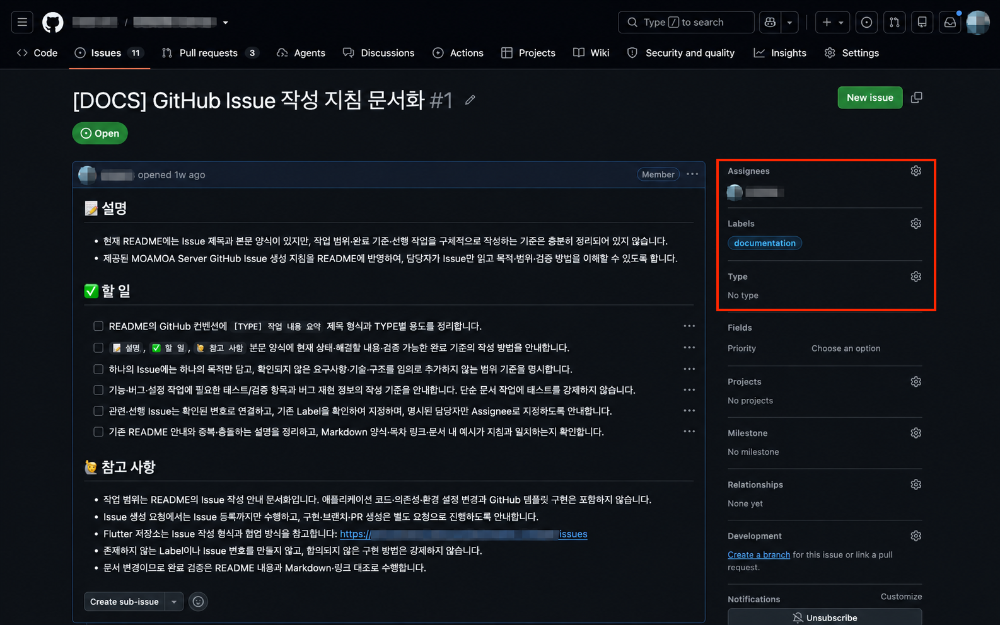

# Issue Guide (A&I) — 작업을 시작하기 전에

> **대상:** A&I 웹·모바일·백엔드·AI 트랙 구성원  
> **목적:** 작업의 이유, 범위, 완료 기준을 다른 팀원도 이해할 수 있도록 기록합니다.

이 문서는 [MOAMOA Server](https://github.com/Team-AnI/MOAMOA-Server/blob/main/README.md), [MOAMOA Flutter](https://github.com/Team-AnI/MOAMOA-Flutter/blob/main/README.md)의 공통 흐름을 바탕으로 작성한 **실전 안내**입니다. 저장소에 별도 템플릿·규칙이 있다면 해당 프로젝트 규칙을 우선합니다.

## 1. Issue가 필요한 이유

Issue는 '할 일'뿐 아니라 **왜 필요한지, 누가 맡는지, 언제 완료인지**를 합의하는 공간입니다. 기능 구현, 버그 수정, UI 개선, 테스트, CI, 문서 및 논의도 Issue로 관리할 수 있습니다.



## 2. Issue 만들기

1. 작업할 저장소의 **Issues → New issue**를 엽니다.
2. 템플릿이 있으면 작업 유형에 맞는 템플릿을 선택합니다. MOAMOA Flutter에는 기능·버그·문서·기타 작업 템플릿이 있습니다. 저장소에 따라 템플릿이 없을 수 있습니다.
3. 제목과 본문을 작성합니다.
4. **Assignees**(담당자), **Labels**(작업 분류), 필요한 경우 **Projects / Milestone**을 설정합니다.
5. Issue 생성 후 번호를 확인합니다.





## 3. 제목 규칙

두 MOAMOA 저장소에서 사용하는 기본 형태는 다음과 같습니다.

```text
[TYPE] 작업 내용 요약
```

| Type | 설명 | 예시 |
| --- | --- | --- |
| `FEAT` | 기능 추가 | `[FEAT] 로그인 상태 표시` |
| `FIX` | 버그 수정 | `[FIX] 로그인 실패 메시지 누락` |
| `REFACTOR` | 구조 개선 | `[REFACTOR] 인증 상태 책임 분리` |
| `DESIGN` | UI/디자인 | `[DESIGN] 홈 화면 여백 조정` |
| `DOCS` | 문서 | `[DOCS] 협업 가이드 보완` |
| `CHORE` | 설정·의존성 | `[CHORE] 개발 도구 버전 정리` |
| `TEST` | 테스트 | `[TEST] 로그인 실패 검증 추가` |
| `CI` | 자동화 | `[CI] PR 검증 워크플로 추가` |

`DESIGN`은 Flutter README에 명시된 유형입니다. 팀별로 사용 가능한 유형이 다를 수 있으므로 기존 저장소 컨벤션을 먼저 확인합니다.

## 4. 본문 템플릿

```markdown
## 📝 설명
- 해결할 문제와 필요한 이유를 작성합니다.

## ✅ 할 일
- [ ] 정상 상황의 완료 기준
- [ ] 실패·예외 상황의 완료 기준
- [ ] 변경 내용의 검증 결과 확인

## 🙋 참고 사항
- 관련 문서·디자인·API 명세·선행 Issue
- 결정되지 않은 사항
```

**나쁜 예:** `- [ ] 오류 처리 개선`  
**좋은 예:** `- [ ] 인증 실패 시 사용자에게 오류 메시지가 표시되는지 확인`

### 버그 Issue에 추가할 내용

```markdown
## 🐞 재현 방법
1. 사전 조건
2. 재현 순서

## 기대 동작 / 실제 동작
- 기대:
- 실제:

## 환경
- 앱/서버 버전 또는 브랜치:
- OS/브라우저/기기/실행 환경:
- 오류 로그 또는 화면 (민감 정보 제거):
```

UI 문제는 화면과 기기 정보를, API 문제는 요청·응답 및 상태 코드를, AI/데이터 문제는 재현 가능한 데이터 조건·실행 방법을 가능한 범위에서 기록합니다. 비밀번호·토큰·실사용자 데이터는 첨부하지 않습니다.

## 5. Issue와 PR 연결

- `Refs #12`: 관련 Issue 참조용 표현(자동 종료하지 않음)
- `Closes #12`, `Fixes #12`: GitHub가 인식하는 종료 키워드. 지원되는 병합 조건에서 Issue를 자동 종료할 수 있음
- 작업을 하지 않기로 결정했다면 사유를 기록하고 종료합니다.

> Issue 번호는 **그 저장소 내에서** 해석됩니다. 다른 저장소 Issue를 참조하려면 `Team-AnI/저장소명#번호` 또는 전체 링크를 사용하세요.

## 6. 작업 전 체크리스트

- [ ] 문제와 작업 이유가 분명한가?
- [ ] 한 Issue에 무관한 작업이 섞이지 않았는가?
- [ ] 확인할 수 있는 완료 기준이 있는가?
- [ ] 담당자와 관련 자료가 연결되어 있는가?
- [ ] 미정 사항을 추측으로 확정하지 않았는가?

## 관련 문서

- [PR 작성 및 리뷰 실전 가이드](PR_WORKFLOW_GUIDE.md)
- [A&I PR 작성 원칙](PR_GUIDE.md)
- [A&I PR/리뷰 운영 원칙](PR_REVIEW_GUIDE.md)
