# Pull Request & Code Review Guide (A&I) — 제출부터 Merge까지

> **대상:** A&I 웹·모바일·백엔드·AI 트랙 구성원  
> **목적:** 작은 변경을 올리고, 검증 근거를 공유하고, 존중하는 리뷰로 품질을 높입니다.

이 문서는 [MOAMOA Server](https://github.com/Team-AnI/MOAMOA-Server/blob/main/README.md), [MOAMOA Flutter](https://github.com/Team-AnI/MOAMOA-Flutter/blob/main/README.md)의 실제 협업 흐름을 예시로 설명합니다. [A&I 공통 PR 가이드](PR_GUIDE.md), [리뷰 운영 가이드](PR_REVIEW_GUIDE.md), [커밋 컨벤션](COMMIT_CONVENTION.md)과 함께 읽어 주세요. **A&I 기본 규칙은 MOAMOA의 공통 방식으로 통일하되, 프로젝트별 자동 검사 및 별도 운영 규칙은 해당 저장소 문서를 따릅니다.**

## 1. 전체 흐름

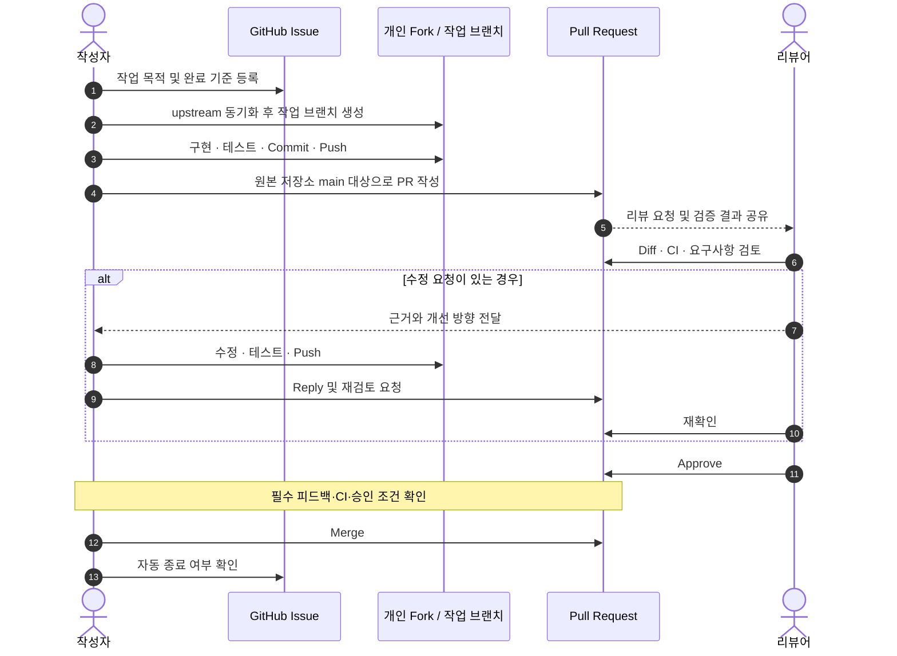

- **Issue:** 무엇을, 왜 바꾸는가?
- **PR:** 무엇을 바꿨으며 어떻게 확인했는가?
- **Review:** 요구사항·안전성·변경 범위를 함께 점검했는가?
- **Merge:** 프로젝트에서 정한 승인·검증 조건을 충족했는가?

## 2. Branch와 Commit

두 MOAMOA 프로젝트는 개인 Fork에서 작업하고 팀 원본 저장소의 `main`을 대상으로 PR을 제출합니다.

```bash
# 개인 Fork를 clone하고 upstream을 등록했다고 가정
# 첫 작업 전 remote 상태 확인
git remote -v
git switch main
git pull --ff-only upstream main
git switch -c 'feature/#12-login'
```

두 저장소의 작업 브랜치 예시는 `feature/#번호-내용`, `fix/#번호-내용`, `docs/#번호-내용`입니다. **A&I 조직의 기본 규칙도 MOAMOA 형식인 `feature/#번호-내용`을 사용합니다.** 저장소별 자동화나 별도 합의가 있다면 해당 프로젝트 README를 우선합니다.

```bash
git status
git diff
git add <변경한-파일>
git commit -m 'feat: 로그인 상태 처리 추가 (#12)'
git push -u origin 'feature/#12-login'
```

MOAMOA 두 저장소에서는 `<type>: <subject> (#이슈번호)`와 한글 제목을 사용합니다. 조직 공통 [커밋 가이드](COMMIT_CONVENTION.md)도 이 형식을 기준으로 합니다. **프로젝트에 이미 적용된 자동 검증**을 먼저 확인하세요. Merge 전에 불필요한 파일, `.env`, 접근 토큰, 개인 정보가 없는지 점검합니다.

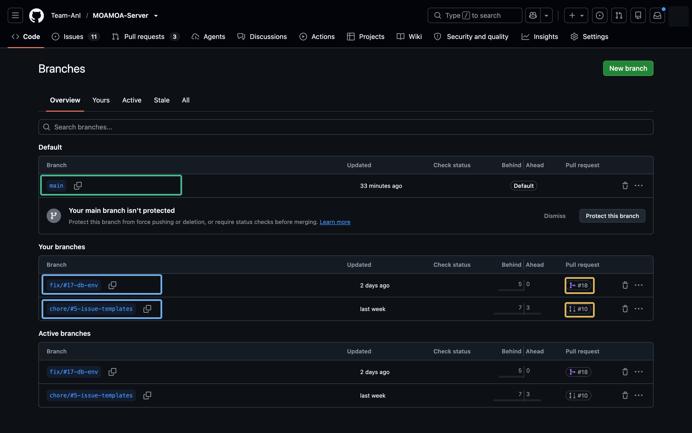

> Flutter 프로젝트는 `make start ISSUE=12 NAME=login-ui`와 `make pr` 등의 자동화 명령을 제공합니다. 서버 프로젝트의 자동화 명령은 해당 저장소 README에서 확인합니다.

## 3. Pull Request 생성

PR 화면에서 **base**는 병합 대상, **compare**는 변경한 브랜치입니다. Fork 기반 MOAMOA에서는 팀 원본 `main`을 base로 선택합니다. `Able to merge`는 자동 병합 가능 여부이지 코드 검토 승인 여부가 아닙니다. 기존 PR이 있다면 `View pull request`가 표시될 수 있습니다.

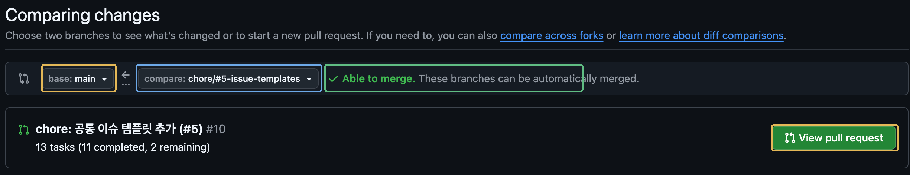

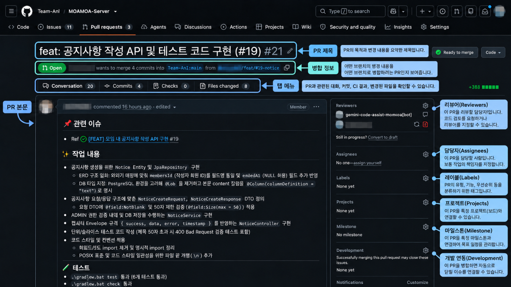

### PR 내용은 무엇을 써야 하나요?

PR 본문 항목과 작성 기준은 [PR 작성 가이드](PR_GUIDE.md)와 [공통 PR 템플릿](../../PULL_REQUEST_TEMPLATE.md)을 참고하세요. UI 변경에는 스크린샷을 추가합니다.

```markdown
## 📌 관련 이슈
- Refs #12

## ✨ 작업 내용
- 로그인 성공/실패 상태를 구분해 표시

## 🧪 테스트 및 검증
- 실행 명령: flutter test
- 결과: (실제로 확인한 결과만 작성)
- 수동 확인: 로그인 성공/실패 시나리오

## 📸 스크린샷 (UI 변경 시)
- 변경 전/후 또는 화면 녹화 링크

## 💬 리뷰 요청 사항
- 실패 시 상태 전환 로직 확인 부탁드립니다.

```

체크리스트는 위 공통 PR 템플릿의 항목을 사용합니다.

이것은 **설명용 예시**이며, 실제 작성 시 저장소에 자동 표시되는 템플릿을 우선합니다. 테스트 결과는 실제 실행한 내용을 기준으로 작성합니다. Issue 완료 시 자동 종료가 필요하면 `Refs` 대신 올바른 종료 키워드를 사용합니다.

| 작업 유형 | 리뷰어에게 보여줄 근거 |
| --- | --- |
| 웹·Flutter UI | 변경 전/후, 로딩·오류·빈 상태, 사용 기기/브라우저 |
| 백엔드 API | 요청/응답 예시, 권한·유효성 검사, 테스트 결과 |
| AI·데이터 | 실행 조건, 재현 단계, 샘플 결과 및 평가 지표 |
| 공통 문서·설정 | 링크/명령 확인 내용, 영향 범위 |

### 프로젝트별 검증

- **MOAMOA Server:** README에 `./gradlew test`, `./gradlew check` 등 검증 명령이 명시되어 있습니다. 서버 환경에 맞는 실제 실행 결과를 작성합니다.
- **MOAMOA Flutter:** README에 `dart format .`, `flutter analyze`, `flutter test`, Android Debug Build 및 PR 제목 검사 관련 CI가 명시되어 있습니다. CI 상태를 확인합니다.
- **그 밖의 A&I 프로젝트:** 사용하는 CI와 도구는 해당 저장소 문서에서 확인합니다.

## 4. 리뷰어가 확인할 것

### Conversation

관련 Issue·설명·검증 결과·이전 논의를 확인합니다.

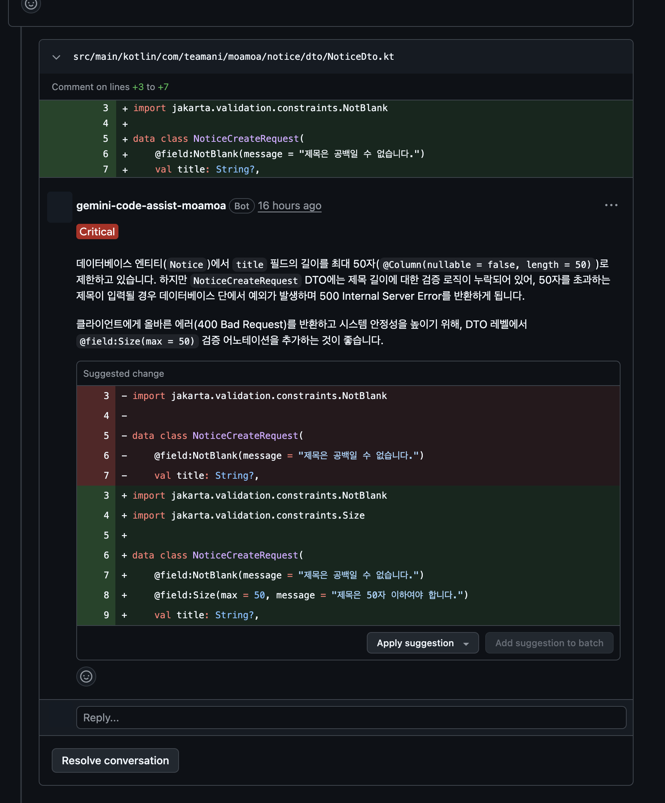

### Files changed

추가(초록색)·삭제(빨간색) 줄과 주변 맥락을 함께 검토합니다.

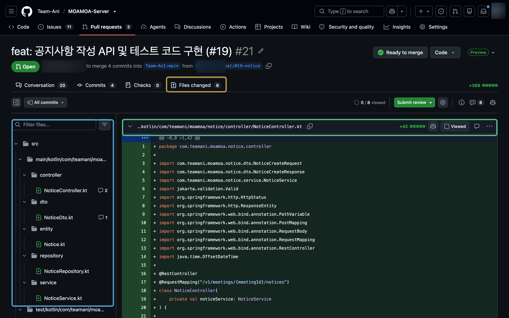

공통 리뷰 기준은 [코드 리뷰 원칙](PR_REVIEW_GUIDE.md), 코드 품질과 가독성 기준은 [클린 코드 가이드](CLEAN_CODE.md)를 확인합니다.

### 한 줄 또는 여러 줄에 코멘트

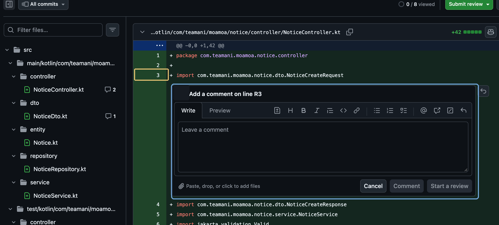

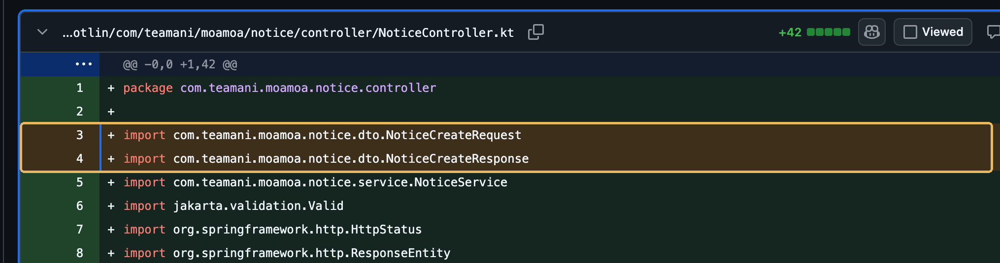

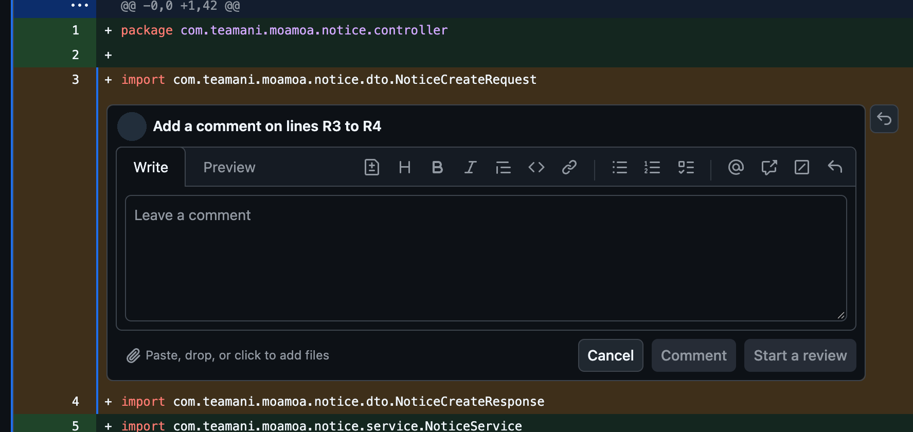

댓글 구분은 [코드 리뷰 원칙의 표기 기준](PR_REVIEW_GUIDE.md)을 따릅니다. 필요하면 사소한 의견을 `[참고]`로 구분할 수 있지만, 필수 여부는 분명히 밝혀야 합니다.

> `[필수]` 권한 검증 없이 데이터 변경 요청이 처리될 수 있습니다. 인가 검증과 실패 테스트가 필요합니다.
>
> `[질문]` 이 상태를 별도로 분리한 이유가 있을까요?

필수 수정에는 **문제의 원인·사용자 영향·수정 방향**을 함께 적습니다. 확인이 필요한 내용은 질문으로 남깁니다.

## 5. 리뷰 제출 및 피드백 반영

`Finish your review`에서는 `Comment`(의견), `Approve`(승인), `Request changes`(수정 요청) 중 하나를 선택해 `Submit review`합니다. `Start a review`로 여러 댓글을 묶을 수도 있습니다. `Request changes`가 병합을 차단하는지는 저장소 보호 규칙에 따라 달라집니다.

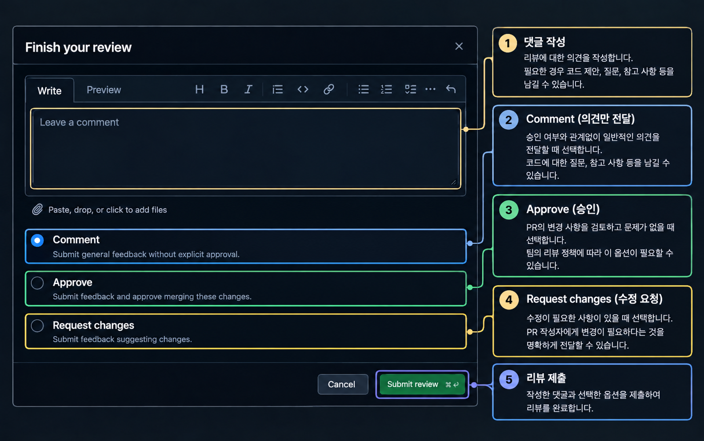

수정 요청을 받았다면 해당 코드를 확인하고 필요한 수정·검증을 거쳐 Push합니다. 댓글에 변경 사항을 설명한 뒤 논의가 끝나면 `Resolve conversation`을 사용합니다.

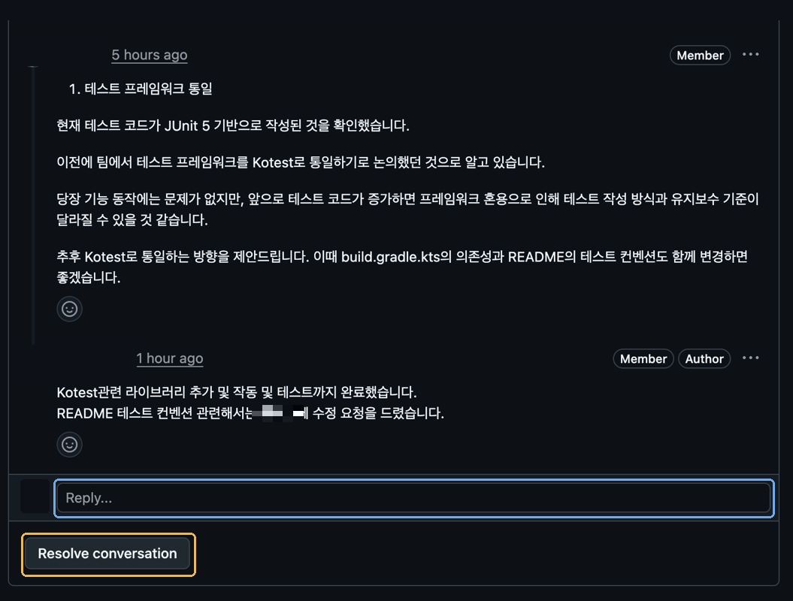

## 6. Merge 전 확인

- [ ] Issue의 완료 기준에 부합하는가?
- [ ] 변경 범위·민감 정보·관련 문서를 확인했는가?
- [ ] 해당 저장소의 필수 CI/테스트가 통과했는가?
- [ ] 리뷰어와 합의한 필수 수정 사항을 해결했는가?
- [ ] 팀에서 요구하는 승인과 대상 브랜치를 확인했는가?

두 MOAMOA README 모두 **최소 1명 Approve 후 작성자가 Merge**하도록 안내합니다. Flutter는 별도의 CI 조건과 리뷰어 자동 지정 규칙이 있습니다. 승인과 CI의 실제 적용 조건은 저장소별 운영 규칙과 설정을 확인합니다.

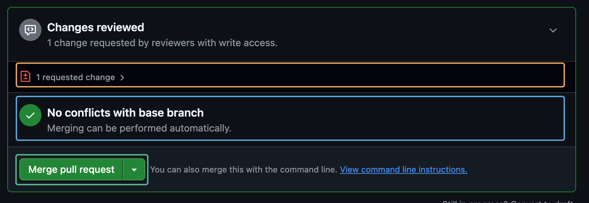

`No conflicts with base branch`는 충돌 여부를 나타냅니다. Merge 전에는 리뷰 완료와 프로젝트의 승인·검증 조건을 함께 확인합니다.

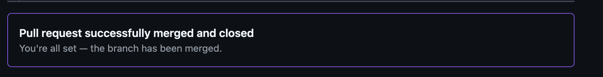

PR 병합 후에는 종료 키워드·대상 저장소·기본 브랜치 병합 조건과 Issue 상태를 확인합니다.

## 관련 문서

- [Issue 작성 실전 가이드](ISSUE_GUIDE.md)
- [A&I PR 작성 가이드](PR_GUIDE.md)
- [A&I PR/리뷰 운영 가이드](PR_REVIEW_GUIDE.md)
- [A&I 커밋 컨벤션](COMMIT_CONVENTION.md)
